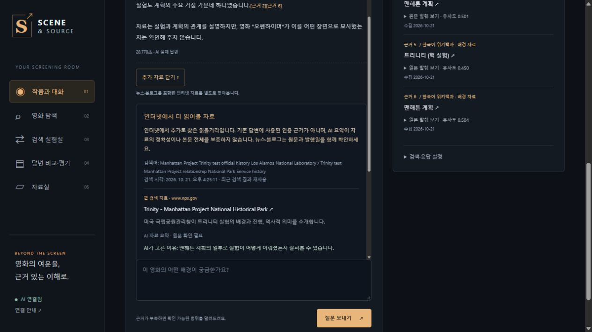
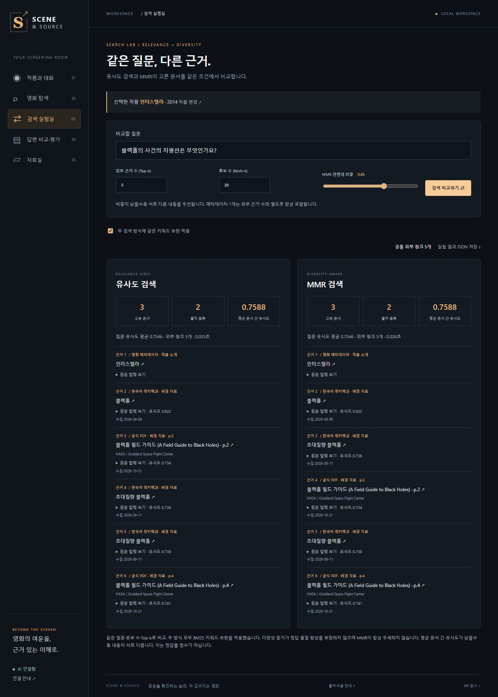
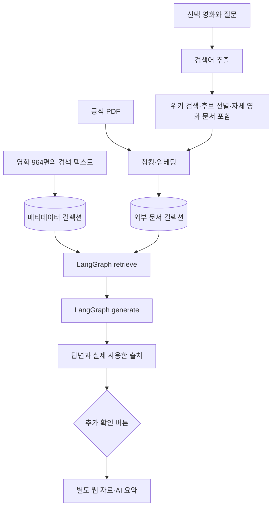

# AI_project_2 · Scene & Source

영화 속 장면과 현실의 과학·역사를 구분하고, 실제 사용한 원문을 함께 보여주는 **근거 기반 영화 지식 서비스**입니다.

[서비스 체험](https://scene-source.onrender.com/) · [설계](docs/architecture.md) · [검증과 한계](docs/validation.md) · [보안·공개 범위](SECURITY.md)



## 프로젝트 소개

영화의 줄거리나 AI의 내부 지식만으로 실제 사실을 단정하기 쉽다는 문제에서 시작했습니다. 964편의 영화 정보와 질문에 맞는 위키백과·공식 PDF를 검색하고, 답변에서 사용한 자료만 인용합니다. 자료가 없으면 확인 불가로 답하고, 사용자가 원할 때 별도의 웹 자료를 추가로 확인합니다.

- 진행 기록: 2026-10-21~2026-10-23. 기록으로 확인되는 작업 기간이며 공식 교육 일정 전체를 뜻하지 않습니다.
- 서비스 방향: 영화 속 사실 확인·배경 해설. 디자인: 어두운 영화관 스타일.
- AI 도구를 활용한 개발 프로젝트입니다. 사용자가 목표·범위·화면 방향·배포 조건을 결정했고, Codex가 코드 작성·수정·테스트·배포 실행을 지원했습니다. 직접 코딩 비율·팀 기여도·운영 성과를 추정해 표시하지 않습니다.
- 이 저장소는 포트폴리오용 공개본입니다. 학교 제출용 원본 데이터와 개인 점검표를 포함한 전체 제출본과 구분합니다.

## 주요 기능

| 기능 | 구현 |
|---|---|
| 작품과 대화 | 964편 선택, 배경 해설·사실 확인, 영화별·모드별 대화 분리 |
| 근거 중심 답변 | 메타데이터 + 외부 문서 검색, 실제 사용한 인용·원문 링크·PDF 쪽 표시 |
| 자연어 영화 탐색 | 연도·언어·장르·상영시간 필터와 AI 후보 검증, 작품 카드에서 대화로 이동 |
| 검색 실험실 | 동일 질문의 Similarity/MMR, 문서 다양성·중복도·처리시간 비교 |
| RAG 전후 비교 | 같은 모델·지침·질문 6개에 대한 실제 12응답, 원문 및 MD/JSON/CSV 내보내기 |
| 다중 출처 | 위키백과 + NASA 공식 PDF. 로컬에서는 사용자 PDF 추가·삭제 가능 |
| 추가 확인 | 첫 답변을 유지한 별도 웹 검색. 뉴스·블로그 등의 제목·원문 링크·AI 요약 표시 |
| 공개 이용 제어 | 방문자별 작업 격리, 요청·AI 호출 한도, 관리자 기능 제한 |



## 기술 스택

| 영역 | 기술 |
|---|---|
| 화면 | HTML, CSS, JavaScript / Streamlit 보조 화면 |
| 서버 | Python 3.12, FastAPI, Pydantic, Uvicorn |
| RAG | LangGraph, ChromaDB, 의미 검색·BM25 보완·MMR |
| 로컬 임베딩 | FastEmbed ONNX 다국어 MiniLM, CPU, 384차원 |
| 공개 임베딩 | GMS text-embedding-3-small, 384차원, 사전 계산·SQLite 캐시 |
| AI·웹 검색 | SSAFY GMS, gpt-6-luna, Responses web_search |
| 문서·저장 | requests, pypdf, SQLite |
| 배포·검증 | Docker, Render Free, GitHub Actions, pytest |

## 동작 구조



LangGraph의 처리 노드는 `retrieve`와 `generate` 두 개입니다. 수집은 그래프 전에 수행합니다. 영화 메타데이터는 항상 포함하고, 외부 문서는 영화 ID로 제한해 검색합니다. 문서 안의 지시는 데이터로만 취급하며 답변에 없는 인용 번호를 사용하면 차단합니다.

## 실행 방법

### Windows 로컬

Python 3.12를 준비하고 아래 명령을 실행합니다.

```powershell
git clone https://github.com/marlanee/AI_project_2.git
cd AI_project_2
powershell -NoProfile -ExecutionPolicy Bypass -File .\setup.ps1
```

`.env.example`을 참고해 `.env`의 `WIKI_CONTACT`에 영문 이메일 또는 연락 가능한 URL을 입력합니다. 실시간 위키 요청의 User-Agent로 사용됩니다. AI 답변이 필요하면 본인의 `GMS_KEY`를 설정합니다. 키는 커밋하지 않습니다.

```dotenv
GMS_KEY=
GMS_BASE_URL=https://gms.ssafy.io/gmsapi/api.openai.com/v1/
GMS_MODEL=gpt-6-luna
WIKI_CONTACT=https://github.com/marlanee/AI_project_2
SCENE_PUBLIC=0
```

```powershell
powershell -NoProfile -ExecutionPolicy Bypass -File .\run.ps1
```

주소는 http://127.0.0.1:8503/ 입니다. 첫 설치에는 모델 다운로드와 색인 시간이 필요합니다. 공개 카탈로그에는 원본 줄거리가 없고 외부 문서는 실시간으로 수집하므로 인터넷이 필요합니다. API 키가 없어도 로컬 임베딩·탐색·원문 발췌를 사용할 수 있지만 AI 생성 답변과 웹 추가 확인은 사용할 수 없습니다.

Streamlit 보조 화면:

```powershell
.\.venv\Scripts\python.exe -m streamlit run app.py --server.address 127.0.0.1 --server.port 8502
```

### Docker·Render

```bash
docker build -t ai-project-2 .
docker run --rm -p 10000:10000 --env-file .env -e SCENE_PUBLIC=1 -e APP_PUBLIC_URL=http://127.0.0.1:10000 ai-project-2
```

Render에서는 Docker Web Service로 연결하고 `/healthz`를 상태 경로로 사용합니다. GMS_KEY와 WIKI_CONTACT는 서버의 비밀 환경변수에 설정합니다. 기존 체험 주소는 앞서 배포한 Scene & Source v2.1.1이며, 새 저장소 생성이 기존 서비스의 자동 배포 연결을 변경하지는 않습니다.

공개 서버는 원격 임베딩을 사용하고 키 없는 이미지 빌드를 위해 공개용 사전 계산 벡터를 포함합니다. 무료 서버의 임시 저장소는 재시작 시 사라질 수 있습니다. PDF 변경·평가 실행은 공개 서버에서 제한하고 로컬에서 제공합니다.

## 확인한 결과와 개선 과정

| 항목 | 확인한 내용 |
|---|---|
| 데이터 | 영화 964편, 공개본의 소개는 사실 필드로 재구성. 원본 줄거리·평점 제외 |
| 로컬 전체 제출본 | 2026-10-23 자동 테스트 66개 통과. 공개본 회귀 검사는 아래 별도 기록 |
| 실제 AI | 6질문의 전후 응답 12개, 근거 부족 보류·후속 질문·문서 주입 거절·PDF 인용 사례 확인 |
| 설정 변경 | 동일 문서 청크 1000/200에서 9개, 600/100에서 18개. 외부 Top-k 2/5는 메타 포함 3/6개 |
| 긴 한국어 입력 | 128토큰 제한에 따른 뒷부분 잘림을 120토큰 창별 벡터 평균·정규화로 보완 |
| 무료 메모리 한도 | 로컬 모델 적재 약 674MiB로 한도 초과 → 공개용 원격 임베딩·캐시 분리. 과거 공개 실측 약 227.6MiB |
| 동명·연도 차이 | 노이즈는 2024년 영화제 공개/2025년 국내 개봉을 확인하고 영문 자체 문서를 보완. 원문 제목·revision 유지 |
| 원문 의미 검토 | 인용 번호가 있어도 과장된 추론이 가능함을 전후 비교에서 확인. 실패 사례와 서비스 지침 보완을 기록 |

정확도 향상률·사용자 수·개발시간 단축률은 측정하지 않았습니다. 테스트 통과는 모든 질문의 사실 정확성을 보증하지 않습니다. 자세한 범위는 [검증 문서](docs/validation.md)에 있습니다.

## 테스트

```bash
python -m pytest tests/test_core.py tests/test_gms_contract.py tests/test_advanced.py tests/test_finish.py tests/test_remote_embeddings.py tests/test_web_research.py -q
```

위 검사는 API 키 없이 실행하는 단위·계약 검사입니다. 실제 AI 사용은 별도 검증이며 사용량이 발생합니다.

```bash
python verify_complete.py --run-api
python verify_gms.py --run-api --compare
```

학교 내부 원본에 의존하는 로컬 전체 시연과 공개용 코드의 검사 범위를 구분합니다. 전체 폴더에 대한 무조건적인 `pytest` 실행은 네트워크·로컬 모델 준비가 필요한 추가 UI/임베딩 검사를 포함합니다.

## 코드 구조

```text
web/                       HTML·CSS·JavaScript 화면
scene_source/api.py         API·작업 큐·진행 상태
scene_source/data.py        카탈로그·색인 텍스트·검증된 별칭
scene_source/sources.py     검색어·문서 선별·수집·캐시
scene_source/store.py       청킹·색인·검색
scene_source/pipeline.py    retrieve → generate
scene_source/prompts.py     검색어·선별·답변 지침
scene_source/experiments.py MMR·RAG 전후 비교·평가
scene_source/web_research.py 별도 웹 검색 자료 검증
public_data/               공개 카탈로그·벡터·비교 참고 기록
docs/                      포트폴리오 설계·검증·화면
tests/                     회귀 검사
```

## 보안과 출처

키·개인 연락처·개인 점검표·학교 과제 PDF/ZIP·원본 줄거리·평점·가상환경·실행 DB·캐시·로그는 게시 대상에서 제외했습니다. 기존 개발 저장소의 Git 이력을 복사하지 않고 검토한 파일로 새 이력을 시작했습니다. [보안 범위](SECURITY.md)를 확인하세요.

- 공개 카탈로그는 TMDB 기반 데이터의 제목·감독·연도 등 사실 필드로 구성하고 각 원문 링크를 유지합니다. TMDB의 보증·인증을 받은 서비스가 아닙니다.
- 위키백과 발췌·보완 사본은 [CC BY-SA 4.0](https://creativecommons.org/licenses/by-sa/4.0/) 조건을 따릅니다. 보완 영문 문서는 [Noise (2024 film)](https://en.wikipedia.org/wiki/Noise_(2024_film)), revision 1378460068입니다. 기여자와 편집 이력은 원문에서 확인할 수 있습니다. 변경 사항은 추출·청킹·색인 및 표시용 발췌입니다.
- NASA 자료는 [공식 소개](https://science.nasa.gov/resource/a-field-guide-to-black-holes-booklet/)에서 가져오고 발행기관·원문 URL·쪽을 표시합니다. 표장과 제3자 자료의 조건은 구분합니다.
- 공개 비교 기록의 영화 메타데이터는 사실 요약으로 교체했다는 표식을 보존했습니다. 최초 개발 실험 당시 입력과 완전히 같은 데이터라고 주장하지 않습니다.

## 남은 개선

무료 서버의 첫 응답 지연, 주장별 원문 지지 검사, 검색 누락과 자료 오류, OCR 없는 PDF 처리, 브라우저 단위 대화 저장의 한계를 개선 과제로 남겼습니다. 공개 접속별 시간당 100회·전체 UTC 하루 100회 논리 AI 호출 제한과 별도 단시간 요청 제한을 적용합니다. 도구 호출·재시도는 공급자 사용량에 추가 집계될 수 있습니다.
